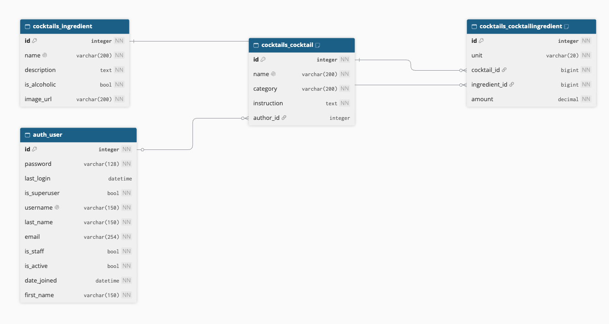

# Cocktails API (Solvro recruitment task)

REST API for managing cocktails and their ingredients, built with Django, Django REST Framework and SQLite.

## Setup

Requires Python 3.12+.

```bash
python3 -m venv .venv
source .venv/bin/activate
pip install -r requirements.txt
python manage.py migrate
python manage.py createsuperuser #creates an Admin account
python manage.py runserver
```

The API is available at `http://127.0.0.1:8000/api/`.

## Authentication

JWT-based. Register at `POST /api/auth/register/`, then get a token at `POST /api/auth/login/` and send it as `Authorization: Bearer <token>`. In Swagger UI, use the **Authorize** button.

- Everyone can browse cocktails and ingredients.
- Logged-in users can add cocktails and ingredients.
- A cocktail (and its ingredients list) can be edited or deleted only by its author or an Admin.
- Admins are users created with `createsuperuser` command.

## Docs
API documentation (Swagger UI): `http://127.0.0.1:8000/api/docs/`.

## Database schema

